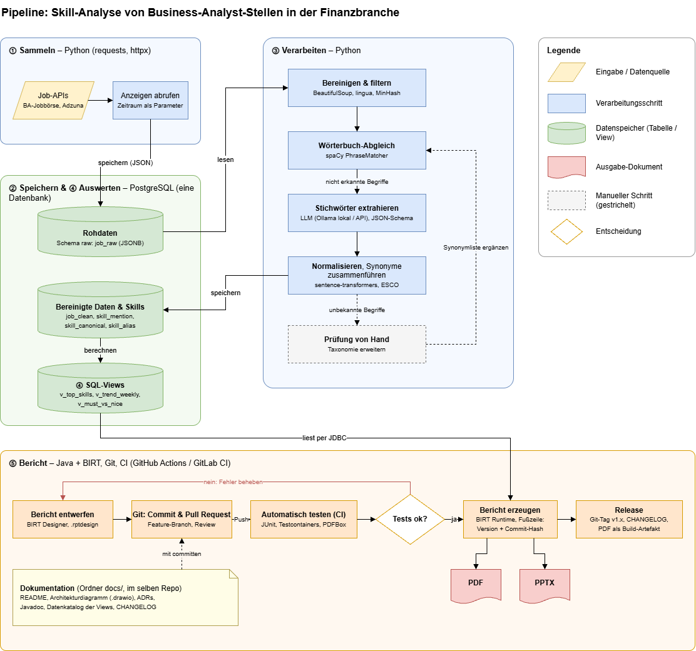

# Job-Market-Analyse: Skills für Business Analysts in der Finanzbranche

TODO: 2–3 Sätze – Was macht das Projekt? Für wen? Was ist das Ergebnis?

## Architektur


TODO: Kurz die 5 Bereiche (Sammeln, Speichern, Verarbeiten, Auswerten, Bericht) in je einem Satz.

## Tech-Stack
TODO: Tabelle oder Liste – Python, PostgreSQL, Docker, Java/BIRT, …

## Voraussetzungen
- Docker Desktop
- Python 3.12+
- TODO: weitere?

## Setup
TODO: Schritt für Schritt alle Befehle, die du in 0.2 und 0.3 ausgeführt hast:
1. Repo klonen
2. `.env` aus `.env.example` erstellen und Passwort setzen
3. Datenbank starten
4. Python-Umgebung anlegen, aktivieren und Pakete installieren
5. Tests ausführen

## Projektstruktur

```text
job-market-analyse/
├── docs/
│   ├── adr/              # Architekturentscheidungen (ADRs)
│   ├── architecture/     # Pipeline-Diagramm (.drawio + .png)
│   └── notes.md          # Lernnotizen
├── ingestion/            # Schritt 1: Anzeigen über Job-APIs abrufen
├── processing/           # Schritt 3–5: Bereinigen, Extrahieren, Normalisieren
│   └── db.py             # Datenbankverbindung
├── report/               # Schritt 7: Java + BIRT
├── sql/                  # Tabellen und Views
├── tests/                # pytest-Tests
├── .env.example          # Vorlage für Zugangsdaten
├── docker-compose.yml    # PostgreSQL-Container
├── pyproject.toml        # pytest-Konfiguration
├── requirements.txt      # Python-Pakete
└── README.md
```

## Dokumentation
- [Architekturentscheidungen](docs/adr/)
- [Lernnotizen](docs/notes.md)

## Status
Phase 0 (Setup) ✅ – nächster Schritt: Phase 1 (Walking Skeleton)